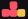
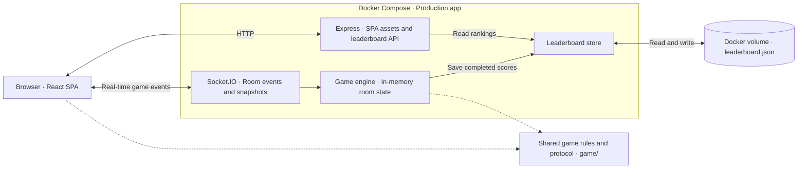

#  Red Tetris

A networked falling-block puzzle for solo and multiplayer play.

## Run with Docker Compose

With Docker Compose and Make installed, build and start the production app.

```sh
make up
```

Open <http://localhost:3000> and enter a room and player name, or join directly at a URL such as <http://localhost:3000/Arcade/Ada>. Set `PORT` to change the published host port.

Use `make down` to stop the app and keep saved scores. `make clean` removes the containers, network, app image, and leaderboard volume, including its saved scores.

## Play

| Input | Action |
| --- | --- |
| ← or → | Move left or right |
| ↑ | Rotate clockwise |
| ↓ | Soft drop one row |
| Space | Hard drop and lock |

The first player in a room hosts and chooses when to start each round. In multiplayer, everyone receives the same piece sequence. Clearing two or more lines raises the other players’ boards by one fewer penalty row than the number of lines cleared. The opponent displays show the height of the settled blocks in each column. The last survivor wins. In solo, the round ends when a piece cannot spawn.

| Mode | Rules |
| --- | --- |
| Classic | 500 ms gravity and no scoring |
| Scored Classic | Classic rules with scoring |
| Invisible Pieces | The falling piece becomes visible when it locks |
| Fast Gravity | 250 ms gravity with scoring |

A clear of one, two, three, or four rows in a bonus mode earns 100, 300, 500, or 800 points respectively. The leaderboard keeps the top ten results separately for each bonus mode and for solo and multiplayer.

## Architecture



One root `package.json` and lockfile cover the whole app. The client and server import game rules and protocol types from `game/`.

- `client/` contains the React SPA, Vite configuration, and browser entry point `client/index.html`. It builds `index.html`, `bundle.js`, and static assets into `client/dist/`.
- `server/` owns Express routing, Socket.IO events, room state, and score storage. Prototype-backed `Player`, `Piece`, and `Game` classes coordinate the game.
- `game/` contains the board rules in `game.ts`, their tests in `game.test.ts`, and the typed Socket.IO protocol in `protocol.ts`. The client uses `@game/` and the server uses `#game/`.
- `config/` contains the repo-wide TypeScript, test, and Docker configuration.

The browser sends `room:join` with a room and name, `round:start` with a mode and round ID, and `player:input` with a keyboard action and round ID. The server checks membership, host authority, and round IDs before updating state. Each `room:snapshot` includes the recipient’s board, the room roster and phase, opponents’ spectra, and the round result when available. Active games live in memory. The bonus leaderboard uses a local file for completed scores.
